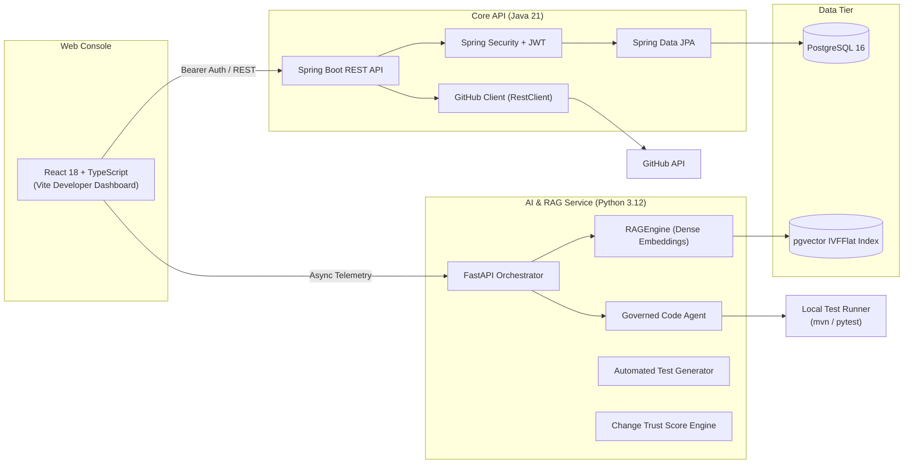

# ForgeX

> Autonomous software engineering and governance platform for AI-assisted development.

[](https://github.com/nellipatlareddyramcharan1316-cyber/Forgex/actions)
[](LICENSE)
[](https://spring.io/)
[](https://fastapi.tiangolo.com/)
[](https://react.dev/)
[](https://www.postgresql.org/)

ForgeX is an autonomous software development platform that helps engineering teams review, branch, and test AI-assisted pull requests safely. Instead of letting LLMs commit code directly to production or staging branches, ForgeX wraps code changes in isolated feature branches, verifies them against local test suites, runs DevSecOps checks, and calculates a Change Trust Score before opening pull requests for human review.

---

## Architecture Overview

ForgeX uses a multi-service architecture designed for security, horizontal scalability, and clean boundary separation:



- **Core Backend (`/backend`)**: Java 21 & Spring Boot 3.3.4 providing project isolation, JWT authentication, task management, and GitHub API sync.
- **AI Microservice (`/ai-service`)**: Python 3.12 & FastAPI handling LLM requirement analysis, repository code ingestion with `pgvector`, code generation, and test generation.
- **Frontend Console (`/frontend`)**: React 18, TypeScript, and Vite providing an interactive workspace console for tracking tasks, reviewing AI patches, and monitoring trust scores.
- **Database (`/infrastructure`)**: PostgreSQL 16 with `pgvector` for relational data and dense vector embeddings (384 dimensions).

---

## Key Features

### 1. Governed Feature Branching
Direct commits to protected branches (`main`, `master`, `release`) are strictly blocked. The coding agent automatically isolates changes into `feature/*` branches, generates clean Conventional Commit diffs, and opens pull requests only after local test verification and developer sign-off.

### 2. Semantic Code Search with pgvector
ForgeX indexes repository source files using AST-aware chunking and 384-dimensional dense semantic embeddings. Cosine similarity queries against PostgreSQL `pgvector` allow agents and developers to locate relevant classes, methods, and configurations in sub-millisecond lookup times.

### 3. Subprocess Test Verification Gates
Before proposing a pull request, ForgeX triggers the repository's native test runner (`mvn test-compile` or `pytest`) in an isolated subprocess. If tests fail or syntax errors are introduced, the pipeline halts immediately, preventing broken code from reaching review.

### 4. DevSecOps & Prompt Injection Defense
- Scans patches for hardcoded credentials, unmasked AWS keys, and SQL injection patterns.
- Applies an instruction isolation barrier to prevent repository code from overriding agent system prompts.
- Runs weekly SAST security audits in GitHub Actions workflows.

### 5. Change Trust Score
Every proposed change is evaluated through an empirical trust score formula (0–100):

$$\text{Trust Score} = 0.20(\text{Req}) + 0.20(\text{Tests}) + 0.25(\text{Security}) + 0.15(\text{Quality}) + 0.10(\text{Deps}) + 0.10(\text{Review})$$

If critical security vulnerabilities or secrets are detected, the score is capped and the deployment gate is hard-blocked, regardless of test coverage.

### 6. Engineering Velocity & Project Management
Tracks sprint velocity, detects delivery bottlenecks (e.g. testing task accumulation vs. active development), and alerts teams to tasks that have remained in progress for more than 4 days.

---

## Repository Structure

```
├── .github/
│   ├── workflows/          # GitHub Actions CI/CD pipelines (test, build, deploy, sast)
│   ├── ISSUE_TEMPLATE/     # Standard bug report and feature request templates
│   └── pull_request_template.md
├── ai-service/             # FastAPI Python service for agent workflows and pgvector RAG
│   ├── rag_engine.py       # Code chunking, embeddings, and pgvector cosine search
│   ├── services.py         # Business logic and agent execution pipelines
│   ├── models.py           # Pydantic schemas for requests and responses
│   ├── main.py             # FastAPI routing and middleware
│   └── tests/              # Pytest test suite (18 unit and integration tests)
├── backend/                # Spring Boot 3 Java 21 REST API
│   ├── src/main/java/      # Controllers, security filters, entities, and services
│   └── src/test/java/      # JUnit 5 and Mockito test suite
├── frontend/               # React 18 TypeScript dashboard
│   ├── src/                # Modular UI components, Kanban boards, and consoles
│   └── package.json
├── docs/                   # Engineering documentation and technical specs
│   ├── ARCHITECTURE.md     # In-depth architectural specification
│   ├── API.md              # Complete REST endpoint reference
│   ├── DATABASE.md         # Relational schema and pgvector DDL
│   └── SECURITY.md         # DevSecOps controls and threat matrix
├── docker-compose.yml      # Local multi-service orchestration
└── test_e2e_apis.py        # End-to-end integration test runner
```

---

## Getting Started

### Prerequisites
- **Docker & Docker Compose** (version 24+)
- Or for local manual setup:
  - Java 21 (Temurin or OpenJDK) & Maven 3.9+
  - Python 3.12+ & pip
  - Node.js 20+ & npm

### Quickstart with Docker Compose

```bash
# Clone the repository
git clone https://github.com/nellipatlareddyramcharan1316-cyber/Forgex.git
cd Forgex

# Start all services
docker compose up --build
```

Services will be accessible at:
- **Web Dashboard**: [http://localhost:5173](http://localhost:5173)
- **Core Backend API**: [http://localhost:8080](http://localhost:8080/api/v1/health)
- **AI Microservice Docs**: [http://localhost:8000/docs](http://localhost:8000/docs)
- **PostgreSQL**: `localhost:5432` (`forgexdb`)

---

### Local Development Setup

#### 1. Backend Service
```bash
cd backend
mvn clean spring-boot:run
```

#### 2. AI Microservice
```bash
cd ai-service
pip install -r requirements.txt
python -m uvicorn main:app --port 8000 --reload
```

#### 3. Frontend Dashboard
```bash
cd frontend
npm install
npm run dev
```

---

## Verification & Testing

ForgeX includes automated self-tests across all layers:

```bash
# Run Java backend tests (JUnit 5 + Mockito)
cd backend && mvn test

# Run AI service tests (Pytest)
cd ai-service && python -m pytest tests/ -v

# Run frontend typecheck
cd frontend && npm run test:run

# Run full end-to-end API test suite
python test_e2e_apis.py
```

---

## Environment Variables

| Variable | Description | Default |
|---|---|---|
| `JWT_SECRET` | 256-bit secret key for signing tokens | Configured in `application.yml` |
| `FORGEX_AI_SERVICE_URL` | Base URL of the Python AI microservice | `http://localhost:8000` |
| `GITHUB_TOKEN` | GitHub personal access token for live API sync | Optional (uses demo simulation if empty) |
| `OPENAI_API_KEY` | OpenAI API key for live LLM requirement decomposition | Optional (uses deterministic schema fallback) |
| `SPRING_PROFILES_ACTIVE` | Active Spring profile | `default` (H2 in-memory) or `prod` (PostgreSQL) |

---

## Contributing

Contributions are welcome. Please read [CONTRIBUTING.md](CONTRIBUTING.md) and check out our [Pull Request Template](.github/pull_request_template.md) before submitting code.

1. Fork the repository.
2. Create your branch (`git checkout -b feature/issue-description`).
3. Commit your changes using Conventional Commits (`git commit -m 'feat: add description'`).
4. Ensure all tests pass (`mvn test` and `pytest tests/`).
5. Open a pull request against `main`.

---

## Security

Please report vulnerabilities confidentially according to our [Security Policy](SECURITY.md). Do not disclose security issues through public GitHub issues.

---

## License

This project is licensed under the [Apache License 2.0](LICENSE).
